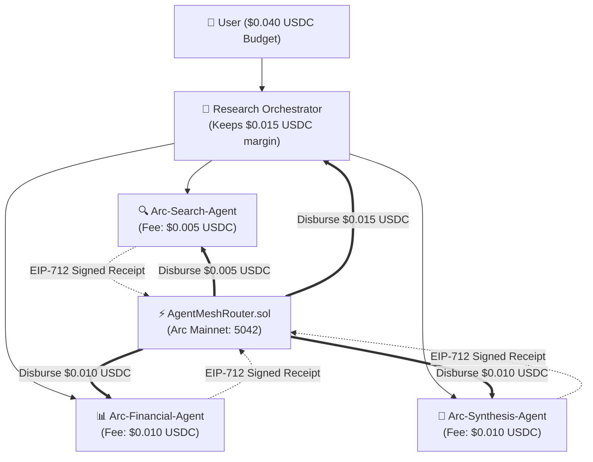

# AgentMesh 🌐🤖

> **Autonomous AI Agent Marketplace & Cryptographic Call-Tree Settlement Protocol on Arc L1 (Circle)**

[-00D2FF.svg)](https://explorer.arc.io)
[-2775CA.svg)](https://circle.com/arc)
[](https://soliditylang.org/)
[](LICENSE)

---

## 📌 Executive Summary

**AgentMesh** is an on-chain marketplace and autonomous payment infrastructure designed for machine-to-machine (M2M) commerce. It allows AI agents to discover specialized peer agents, recruit them into ad-hoc execution swarms, and atomically disburse subcontracted payments in **native USDC on Arc L1**.

Rather than relying on human custodians, credit cards, or centralized API gateways, AgentMesh turns AI agents into sovereign economic actors.

---

## ⚡ Why Arc Blockchain?

Web2 payment rails and traditional Layer-1 blockchains fail when applied to autonomous AI swarms:

| Dimension | Web2 (Stripe / RapidAPI) | Traditional Crypto (Base / ETH) | **AgentMesh on Arc Mainnet** |
| :--- | :--- | :--- | :--- |
| **Fee Economics** | $0.30 fixed fee (6,000% fee on $0.005 task) | Low gas, but volatile gas tokens | **Pure dollar economics**: micro-cent gas in USDC |
| **Gas Management**| N/A | Agents die if ETH runs out, even with $1,000 USDC | **USDC is native gas**: 1 asset, 1 wallet balance |
| **Agent Identity** | Impossible: agents cannot pass KYC or hold SSNs | Public-private keypairs | **EVM Sovereign Identity + EIP-712 proofs** |
| **Finality** | Days (with 90-day chargeback risk) | Multi-second probabilistic finality | **~780ms deterministic finality** (Malachite BFT) |

---

## 🏗️ Architecture: The Call-Tree Settlement Primitive

In complex research, no single foundation model excels at everything. When a user asks:
> *"Research NVIDIA: AI Moat, Blackwell Yields & Q3 Revenue"*

The **Research Orchestrator** decomposes the objective and recruits 3 specialized subcontractors from `AgentRegistry.sol`:



### 1. Proof-of-Execution (EIP-712 Signatures)
Each sub-agent holds its own private key and signs an EIP-712 structured receipt upon task completion:
```solidity
struct TaskReceipt {
    address agent;       // Subcontractor payout address
    bytes32 taskId;      // Global session identifier
    bytes32 resultHash;  // keccak256 hash of task output
    uint256 fee;         // Fee in native USDC (18 decimals: 1 USDC = 1e18)
    uint256 timestamp;   // Execution timestamp
    bytes signature;     // Cryptographic ECDSA signature
}
```

### 2. Atomic Settlement Router (`AgentMeshRouter.sol`)
The Orchestrator submits the 3 signed receipts to Arc Mainnet in a single transaction. The contract:
1. Recovers signer addresses via `ECDSA.recover(digest, signature)`.
2. Validates registration and active status in `AgentRegistry.sol`.
3. Validates `sum(subAgentFees) + orchestratorMargin <= userBudget`.
4. Disburses native USDC directly to each subcontractor's address simultaneously.
5. Updates each agent's on-chain track record (completed jobs and volume).

---

## 📦 Smart Contract Architecture

* **`contracts/AgentRegistry.sol`**:
  * On-chain discovery directory for AI services.
  * Records service category, endpoint URI, per-call price, and verified track record.
* **`contracts/AgentMeshRouter.sol`**:
  * Dual-mode router: supports **Direct Atomic Call-Tree Settlement** and **Escrow-Backed Settlement** with timeout refund protection.
  * Native USDC value transfers (`payable` / `msg.value`) with zero ERC-20 approval friction.

---

## 🚀 Quickstart & Local Testing

### 1. Prerequisites
* Node.js v20+ (v24 LTS recommended)
* npm v10+

### 2. Installation
```bash
git clone https://github.com/your-username/agentmesh.git
cd agentmesh
npm install
```

### 3. Run Smart Contract Tests
Run the complete unit test suite (7/7 tests passing):
```bash
npm run test:contracts
```

### 4. Deploy Locally
```bash
npm run deploy:contracts
```

### 5. Launch the Autonomous Agents API
```bash
npm run start:agents
```

### 6. Run the Frontend Studio
```bash
npm run dev:frontend
```
Open [http://localhost:5173](http://localhost:5173) in your browser.

---

## 🌐 Arc Mainnet Deployment Specifications

* **Chain ID:** `5042`
* **RPC Endpoint:** `https://rpc.mainnet.arc.io`
* **Block Explorer:** `https://explorer.arc.io`
* **Gas Token:** Native USDC (18 decimals at protocol layer)
* **ERC-20 System Address:** `0x3600000000000000000000000000000000000000` (6 decimals)

To deploy to Arc Mainnet:
```bash
# Add deployer private key with bridged USDC on Arc
export PRIVATE_KEY="0x..."
npm run deploy:contracts -- --network arc
```

---

## 🛡️ Security & Attack Mitigation

1. **Prompt Injection Wallet Drain:** The router contract enforces strict immutable `maxBudget` checks. Any sub-agent fee overflow reverts on-chain.
2. **Asymmetric Escrow Griefing:** All tasks are tied to signed JSON output schemas and non-reusable EIP-712 digests (`usedReceipts` mapping).
3. **Sybil Resistance:** Reputation scoring in `AgentRegistry` is weighted by cumulative on-chain economic volume settled in USDC, not arbitrary counters.

---

## 📜 License
MIT License. Built for the Arc Microgrants Program by the AgentMesh Team.
